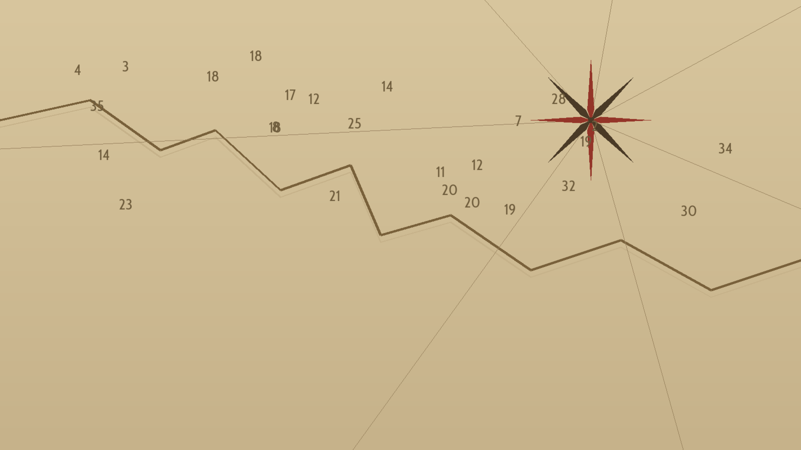
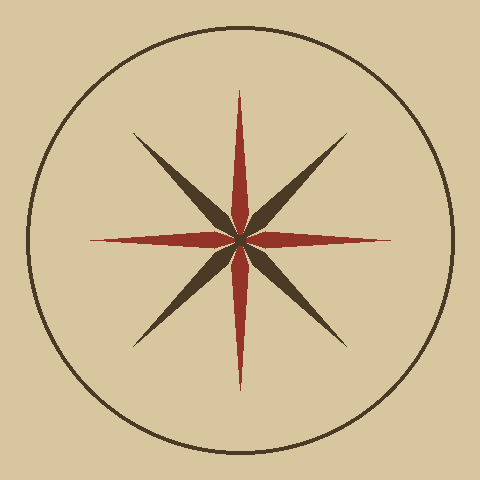

# datascan-data-pattern-replacer

Title block: the name above is set in Cabin Condensed in chart ink on a parchment plate, with a rhumb rule beneath it and one small compass rose at the left of the first heading only, in the manner of a chart title.

# datascan-data-pattern-replacer
Identifies and replaces sensitive data patterns (e.g., credit card numbers, phone numbers) with configurable replacement strings or random data. Uses regular expressions for pattern matching. - Focused on Provides tools to sanitize sensitive data within structured or unstructured data sources. Replaces PII (Personally Identifiable Information) such as names, addresses, phone numbers, and credit card details with realistic, anonymized data using Faker. Supports various data formats like CSV, JSON, and plain text, ensuring data privacy while preserving data utility for testing or development purposes.

Note: --input_format and --output_format must match. The tool reads and writes in the same format and does not convert between text, JSON, and CSV; a mismatched pair is refused with an error instead of writing a mislabeled file.

Note on failed runs: if the patterns file loads no patterns at all, the run exits 1 and writes no output. If any defined pattern has no replacement entry, the run also exits 1 and writes no output, before any input is processed. A run is only reported as Data sanitization complete, at exit 0, when every defined pattern had a replacement to apply.

## Install
`git clone https://github.com/ShadowGuardAI/datascan-data-pattern-replacer`

## Usage
`./datascan-data-pattern-replacer [params]`

## Parameters
- `-h`: Show help message and exit
- `--patterns_file`: Path to the JSON file containing regex patterns and replacements. A file that loads no patterns, or a pattern with no replacement entry, makes the run exit 1 with no output written.
- `--use_faker`: Use Faker to generate realistic replacement data.
- `--faker_locale`: Locale to use for Faker (default: en_US).
- `--input_format`: Format of the input file (text, json, or csv).
- `--output_format`: Must match --input_format; converting between formats is not supported.

## License
Copyright (c) ShadowGuardAI

## Chart drawer notes, gathered in the chart room

The buttons of this re-skin read Swap the Matches, Load the Patterns File, and Open the Chart Drawer. Its headings read No Pattern Ships Inside, Formats Do Not Convert, Order in the File Is Order at Work, Equal Inputs Part Under Faker, and Headers Are Swapped Too. Two identity faults stand in the preserved record above and are flagged, not corrected: the install line names ShadowGuardAI without its hyphen, and the licence line reads Copyright (c) ShadowGuardAI in the same unhyphenated form. The repository LICENSE file carries the MIT License. Its holder line gives a pen name together with a single initial for the remaining name. That fact is recorded. The initial is not expanded. No sample record or concrete data value from any example is printed in this re-skin or on the site.
